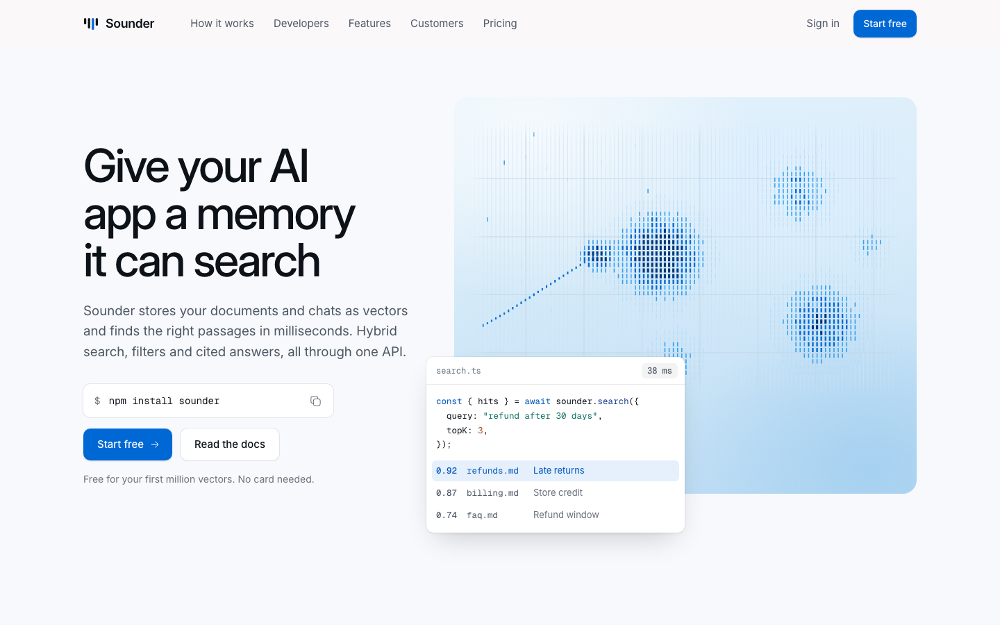

# Sounder

A free landing page template for a made-up product called Sounder, a search and memory service for AI apps (vector search and RAG). It is illustrated with eight animated assets in the Shader style by [Illos](https://illos.dev).

[](https://vercel.com/new/clone?repository-url=https%3A%2F%2Fgithub.com%2Fnavedux%2Fillos-sounder-template)

Live demo: https://illos-sounder-template.vercel.app



The page has a split hero with a copyable install line, a four-step "How it works" row, a code block whose language tabs switch the code and its output, a bento of features, a row of figures, customer quotes, a usage estimate with two sliders, questions that open and close, and a footer.

Sounder is not a real company. Change the name, the copy, the numbers and the prices to your own.

## Run it

You need Node 18 or later.

```
npm install
npm run dev
```

Then open http://localhost:4872.

## Build it

```
npm run build
```

The finished site goes to `dist/`. It is plain HTML, CSS and JavaScript, so any static host can serve it. `npm run preview` serves `dist/` locally so you can check the build.

## Edit it

- `index.html` holds the page and all its copy.
- `src/style.css` holds the styles. Colours, the radius scale, the shadows and the type scale are CSS variables at the top.
- `src/main.js` runs the animated assets, the mobile menu, the copy buttons, the language tabs and the usage estimate. The prices for the estimate are the constants near the bottom (`PER_M_VECTORS`, `PER_M_QUERIES` and the free allowance in `estimate`).
- `illos/` holds the animated assets as SVG files, and `shader-runtime.js`, which moves them.
- `public/fonts/` holds Inter and Geist Mono as woff2 files, with their licences (SIL Open Font License).

Each asset sits in the page as a comment such as `<!-- illos:vector-search -->`. The build swaps the comment for the SVG inline, so the asset can read the page's colours. To move an asset, move its comment. To use another one, drop the SVG into `illos/` and add a comment with its file name. Use each asset once per page.

The assets take their colours from the `--illos-*` variables in `src/style.css`. The four `--illos-ramp-*` steps run from the strongest bars to the faintest; change them with `--accent` and every asset follows. The dark blue tile sets its own light ramps, so its asset reads on the dark ground.

## How the motion behaves

- Each asset loops while it is on screen and pauses when it scrolls away. Its field is drawn in WebGL under the SVG.
- With reduced motion turned on in the system settings, or without WebGL, each asset shows one still frame.
- Nothing else on the page moves on its own: no scroll effects, no carousels.

## Licence

The code is MIT. The animated assets are free to use in sites you build from this template, but not to redistribute on their own. See `LICENSE.md`.

## More animated assets

The assets come from [Illos](https://illos.dev), where there are more in the same style, along with the skills that let your coding agent make new ones.
